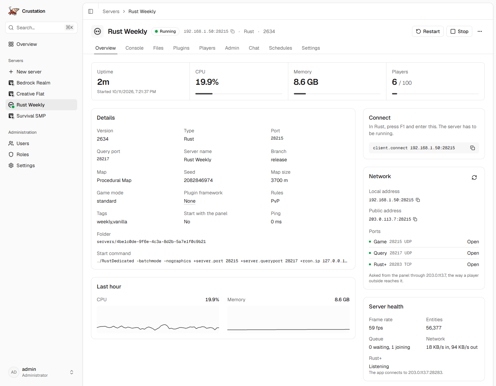
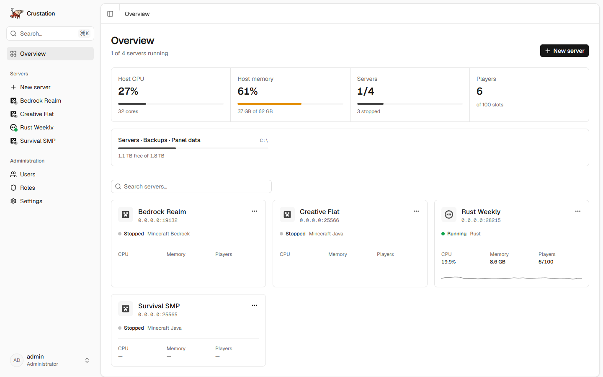
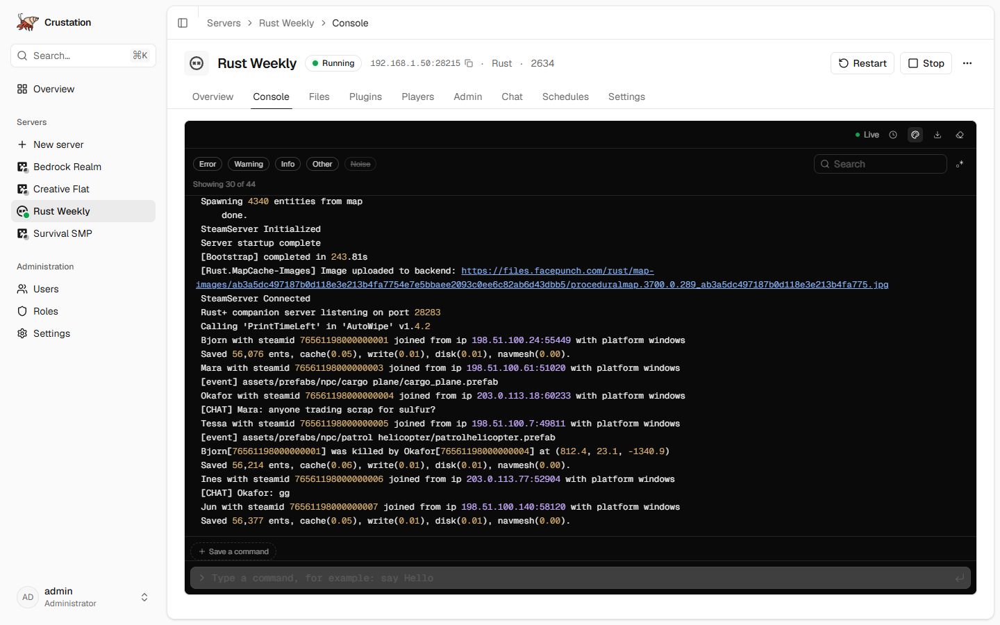
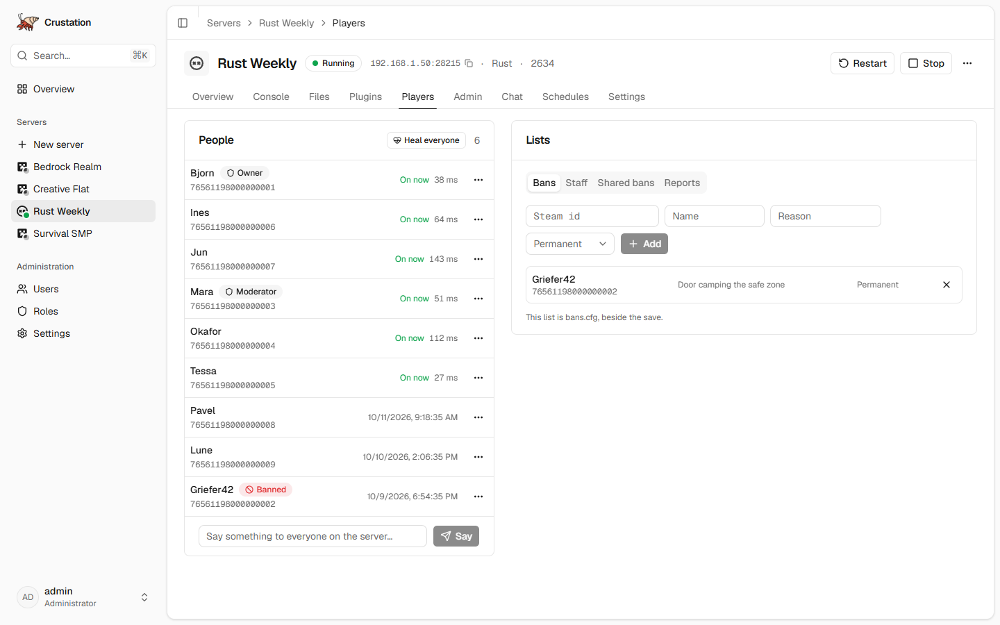
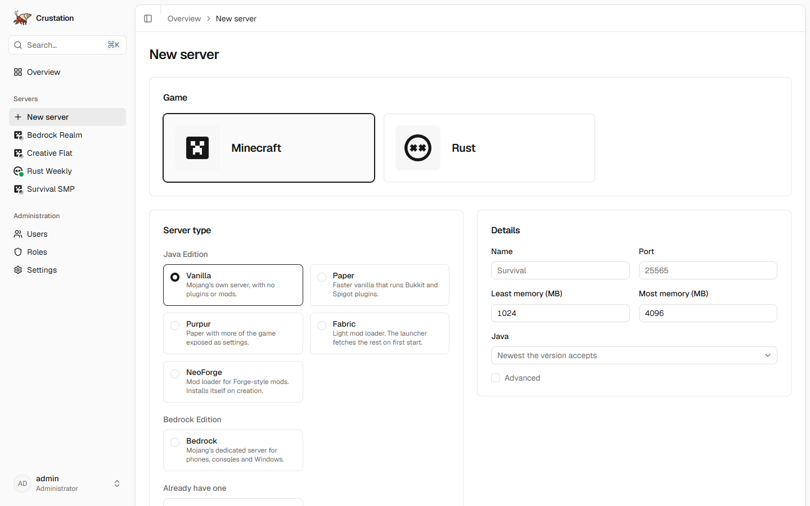

<h1 align="center">
  <br>
  Crustation
</h1>

<p align="center">
  Run your Minecraft, Rust, Enshrouded and Dragonwilds servers from a web page.<br>
  One binary, one container, one SQLite file.
</p>

<p align="center">
  <a href="https://github.com/juddisjudd/crustation/actions/workflows/ci.yml"></a>
  <a href="LICENSE"></a>
  <a href="https://github.com/juddisjudd/crustation/pkgs/container/crustation"></a>
</p>

<p align="center">
  <a href="#install">Install</a> ·
  <a href="#what-it-does">What it does</a> ·
  <a href="#configuration">Configuration</a> ·
  <a href="docs/ROADMAP.md">Roadmap</a>
</p>

<picture>
  <source media="(prefers-color-scheme: dark)" srcset="docs/screenshots/server-dark.png">
  
</picture>

Crustation supervises your game servers and serves the interface from the same process. There is
one container to deploy and one database file to back up.

Crab, Rust, shells. The name wrote itself.

> **Built with AI, directed by a human.** Most of the code here is written by an AI assistant
> working to decisions I make: the architecture, the API contract in [docs/API.md](docs/API.md),
> and the order of work in [docs/ROADMAP.md](docs/ROADMAP.md).
>
> This is not prompt-and-ship. Nothing merges that fails `cargo fmt`, `clippy -D warnings`, the
> test suite or the interface build, and features are exercised against a running panel before
> they go out. It runs on your hardware, so you should know how it was made.

## Quick start

1. Start the container:

   ```bash
   docker run -d --name crustation --stop-timeout 120 \
     -p 8080:8080 \
     -p 25565:25565 -p 19132:19132/udp \
     -p 28015:28015/udp -p 28017:28017/udp -p 28083:28083 \
     -p 15637:15637/udp -p 7777:7777/udp -p 8888:8888/udp \
     -v /srv/crustation/config:/config \
     -v /srv/crustation/servers:/servers \
     -v /srv/crustation/backups:/backups \
     -e PUID=1000 -e PGID=1000 \
     ghcr.io/juddisjudd/crustation:latest
   ```

2. Open <http://localhost:8080>.
3. Sign in as `admin` with the password in `/srv/crustation/config/first-login.txt`.
4. Choose **New server** and pick a game.

[Install](#install) covers Compose, Unraid, building from source and what each port is for.

## What it does

<table>
  <tr>
    <td width="50%">
      <picture>
        <source media="(prefers-color-scheme: dark)" srcset="docs/screenshots/overview-dark.png">
        
      </picture>
    </td>
    <td width="50%">
      <picture>
        <source media="(prefers-color-scheme: dark)" srcset="docs/screenshots/console-dark.png">
        
      </picture>
    </td>
  </tr>
  <tr>
    <td align="center">Every server and the host on one page</td>
    <td align="center">A live console, with the start-up noise filtered out</td>
  </tr>
  <tr>
    <td>
      <picture>
        <source media="(prefers-color-scheme: dark)" srcset="docs/screenshots/players-dark.png">
        
      </picture>
    </td>
    <td>
      <picture>
        <source media="(prefers-color-scheme: dark)" srcset="docs/screenshots/new-server-dark.png">
        
      </picture>
    </td>
  </tr>
  <tr>
    <td align="center">Players, staff and bans</td>
    <td align="center">A new server in one form</td>
  </tr>
</table>

### Every server

- **Power.** Start, stop, restart and kill, with crash detection and restart on boot. A server
  that is still booting can be stopped too.
- **Console.** Live, with a command box, level filters, search, colour and saved commands.
- **Files.** Browse, edit text in place, upload, download a folder as a zip, unpack.
- **Stats.** The host and each server process, with history.
- **Network.** The local and public address to hand out, and whether each port answers from
  outside, asked through your own public address.
- **Schedules.** Restarts with a countdown in chat, starts, stops and commands, on a repeat, a
  cron line or after another schedule.
- **Access.** Users, roles and API keys, with permissions for each server.
- **MCP.** An MCP server at `/mcp`, so an assistant can read a console and act on a server
  through the same permissions an API key already has. See [docs/API.md](docs/API.md).

### Minecraft, Java and Bedrock

- **Create a server** from Vanilla, Paper, Purpur, Fabric, NeoForge or Bedrock. Crustation
  downloads it, accepts the EULA, sets the port and picks a Java version that suits it. The seed,
  world type, difficulty, game mode and slots are on the same form.
- **Import a server** you already have, from a zip, a folder on the host, or a download link.
- **Players.** Who is on and who has been, operators, kicks, bans, items and teleports, and the
  allow, operator and ban lists. A stopped server gets the change in its files instead.
- **Chat and settings.** Chat, the message of the day with its colours, and a typed
  `server.properties` editor.
- **Add-ons and worlds.** Install a `.mcaddon` or `.mcpack` and it is unpacked where the server
  reads it and switched on for the world you pick. Import a `.mcworld` and it lands under
  `worlds/` under the name it gives itself.

### Rust

- **Create a server** through SteamCMD on the release, staging or aux branch, with the map, seed,
  size, slots and the rest of the start-up settings. The install says what SteamCMD is doing at
  each step, down to how much of the download is done.
- **Players.** Who is on and who has been, kicks, bans for a while or for good, owners and
  moderators, mutes, items and teleports. Heal, revive, kill and clear an inventory with no plugin
  framework installed.
- **Plugins.** Oxide or Carbon on one switch, and plugins uploaded, switched off, or installed
  and updated from uMod. Oxide comes back on its own after every Steam update.
- **Chat and wipes.** Chat as it is said. Wipe the map, the blueprints or everything, with a new
  seed if you want one, by hand or on a schedule.
- **Updates.** The panel notices when Steam has a newer build, then warns players in chat, stops,
  updates and starts again, on one button or whenever Facepunch ships.
- **Health and the map.** Frame rate, entities, queue and network from the game itself, whether
  Rust+ is reachable, and the picture of the map the server is running.
- **Admin.** Every convar with its live value, set for now or kept for every start. Every console
  command with a box to run it. Every item with its picture, given to a player or to everyone.
- **Reports and bans.** F7 reports collected on the players page with their screenshots, and a
  ban list shared by every Rust server on the panel.
- **A quiet console.** What Rust prints on every start is hidden behind a chip, and commands go
  over websocket RCON on the loopback, so the panel's own requests never clutter it.

### Enshrouded

- **Create a server** through SteamCMD with the slots, the chat switches, the browser tags, the
  difficulty preset and every one of the game's own settings, each with its range. Keen ships the
  server for Windows only; the image runs it under Wine, so nothing extra is needed.
- **Roles.** The four roles players join under, each with a password the panel picks, and an
  editor for their names, passwords, permissions and reserved slots.
- **Players and bans.** Who is on and who has been, read from the console, and the ban list with
  a button to lift each one.
- **Updates and stops.** The panel notices when Steam has a newer build and updates on a button
  or a schedule. A stop is Ctrl+C, which saves the world first.

### RuneScape: Dragonwilds

- **Create a server** through SteamCMD with the owner's Player ID, the world's name and password,
  the admin password and which platforms may join. The panel names the world after the server and
  generates the admin password unless you choose one.
- **Players.** Who is on and who has been, read from the console, with each player's Epic id.
- **A safe console.** The world password is taken out of every line the server prints it in.
- **Updates.** The same Steam check and update as the other Steam games, since a client only joins
  a server on its own build.

Neither game reads console commands, so their console is for reading, and their settings are
edited while the server is stopped, because each rewrites its file while it runs.

### Not there yet

Mods from Modrinth, datapacks, webhooks and alerts, and backups.
[docs/ROADMAP.md](docs/ROADMAP.md) has the order they are coming in.

## Install

### Docker

The command under [Quick start](#quick-start) is the whole install. `docker-compose.yml` does the
same thing and also publishes 25500 to 25600 as spare ports for more servers.

| Port  | Protocol | Used by                                          |
| ----- | -------- | ------------------------------------------------ |
| 8080  | TCP      | The panel                                        |
| 25565 | TCP      | Minecraft Java                                   |
| 19132 | UDP      | Minecraft Bedrock                                |
| 28015 | UDP      | Rust, the game                                   |
| 28017 | UDP      | Rust, the Steam query: the game port plus 2      |
| 28083 | TCP      | Rust, the Rust+ phone app: the game port plus 68 |
| 15637 | UDP      | Enshrouded, the game and the server list         |
| 7777  | UDP      | Dragonwilds, the game                            |
| 8888  | UDP      | Dragonwilds, the world settings beacon           |

Worth knowing:

- **Every server needs its ports published.** A second server on another port is not reachable
  until the container publishes that port too. The Network card on a server's overview shows
  whether each port answers.
- **Java is included.** The image carries Java 8, 11, 17, 21 and 25, and each Minecraft server
  starts on whichever one its version asks for.
- **Stopping the container stops every game server first**, all at once, so each can save. A
  server gets its shutdown timeout, 60 seconds unless you changed it, before it is killed. Docker
  only waits 10 seconds by default, which is why the examples raise it to 120. Keep it above the
  longest shutdown timeout you set.
- **Rust, Enshrouded and Dragonwilds need an amd64 host**, because SteamCMD only exists for x86,
  and so does the Wine that runs Enshrouded. A Rust server wants around 10 GB of disk and 8 GB of
  memory or more. Enshrouded takes around 8 GB of disk, and Keen asks for 16 GB of memory.
  Dragonwilds takes around 5 GB of disk, and Jagex asks for 2 GB of memory plus 1 GB a player.
- **Dragonwilds' ports have to match.** Publish its game and beacon ports on the same numbers
  inside and out, or players are sent back to the title screen.

### Unraid

The template lives in
[juddisjudd/unraid-templates](https://github.com/juddisjudd/unraid-templates), the repository
Community Applications already indexes. Two ways to add it:

- **Docker → Add Container → Template URL**, then paste
  <https://raw.githubusercontent.com/juddisjudd/unraid-templates/main/templates/crustation.xml>
- **Community Applications → Additional Repositories**, then add that repository

It maps config, servers and backups as three shares and honours `PUID` and `PGID`, so files stay
owned by your Unraid user rather than root. Its Extra Parameters carry `--stop-timeout=120`; a
container added from an older copy of the template should have that set by hand, under Advanced
View.

### From source

```bash
cd web && pnpm install && pnpm build && cd ..
cargo run --release
```

Data lands in `./config`, `./servers` and `./backups`. For interface work, run `pnpm dev` in
`web/`; Vite proxies the API and the WebSocket to the panel on port 8080.

## First sign-in

The panel creates an administrator the first time it starts.

Set `CRUSTATION_ADMIN_USERNAME` and `CRUSTATION_ADMIN_PASSWORD` to choose your own. Otherwise
Crustation generates a password and writes it to `config/first-login.txt`. Change it after signing
in, then delete that file. Both are read on the first start only, so changing them later does
nothing.

### Locked out

`crustation reset-password <username>` gives that user a new password and prints it. It also signs
them out everywhere, enables the account if it was disabled, and lifts the five-minute cooldown
that five failed sign-ins start. In Docker or on Unraid, run it in the container while the panel
is up:

```bash
docker exec -u crustation crustation crustation reset-password admin
```

`-u crustation` runs it as the panel's own user, so the database stays owned by that user. The
second `crustation` is the container's name; on Unraid it is `Crustation`.

## Configuration

`config/crustation.toml` appears on first start and can be edited. Environment variables override
it, which is how the container is configured.

| Variable                                                                    | Meaning                                                           |
| --------------------------------------------------------------------------- | ----------------------------------------------------------------- |
| `CRUSTATION_PORT`, `CRUSTATION_ADDRESS`                                     | Where the panel listens                                           |
| `CRUSTATION_PUBLIC_URL`                                                     | External address behind a reverse proxy; turns on secure cookies  |
| `CRUSTATION_CONFIG_DIR`, `CRUSTATION_SERVERS_DIR`, `CRUSTATION_BACKUPS_DIR` | Data locations                                                    |
| `CRUSTATION_ADMIN_USERNAME`, `CRUSTATION_ADMIN_PASSWORD`                    | First administrator                                               |
| `CRUSTATION_LOG`                                                            | Log filter, for example `debug`                                   |
| `CRUSTATION_MCP_ENABLED`                                                    | Set to `false` to stop serving the MCP endpoint at `/mcp`         |
| `PUID`, `PGID`                                                              | In the container: the user and group that own the files           |

### Reaching the panel from outside

Forward the game ports on your router, not the panel's. The panel speaks plain HTTP and can run
commands on your machine. To use it away from home, reach it over a VPN, or put it behind a
reverse proxy that adds HTTPS and set `CRUSTATION_PUBLIC_URL` to that address.

## Why another one

[Crafty Controller](https://gitlab.com/crafty-controller/crafty-4) has the right idea and I ran it
for a while. Crustation is the same tool on different foundations: one binary and one SQLite file
to deploy, an API built for a single-page interface, and a WebSocket that re-checks permissions on
every event it sends.

## Contributing

```
src/            the panel: http, auth, supervisor, providers, installs, stats, events
migrations/     SQLite schema
web/            the Svelte interface
docker/         container entrypoint
docs/           architecture, API contract, roadmap
```

- [docs/ARCHITECTURE.md](docs/ARCHITECTURE.md) covers how the pieces fit together.
- [docs/API.md](docs/API.md) is the contract between the panel and the interface. Change one side
  without the other and things break quietly.
- [docs/ROADMAP.md](docs/ROADMAP.md) says what is done and what comes next.

Before opening a pull request:

```bash
cargo fmt --check && cargo clippy --all-targets -- -D warnings && cargo test
cd web && pnpm check && pnpm lint && pnpm build
```

## Licence

AGPL-3.0-or-later. Run a modified copy as a service and you owe the world your changes.
